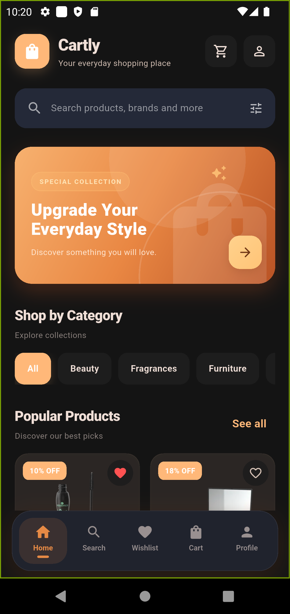
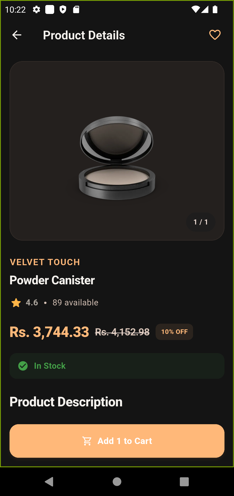
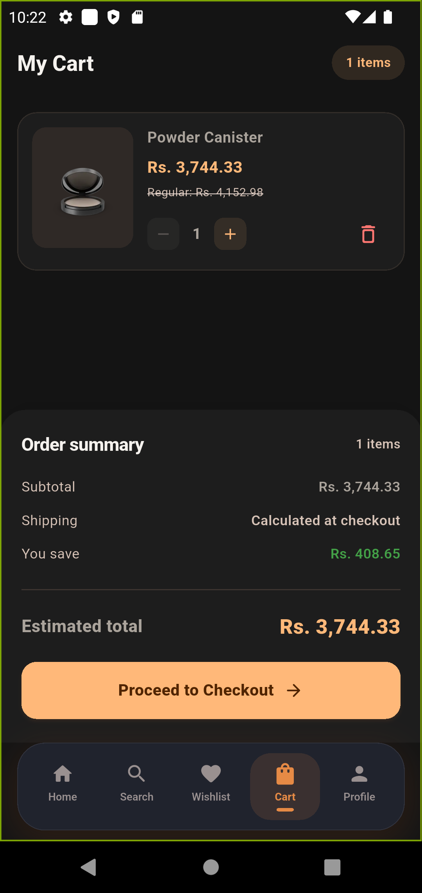
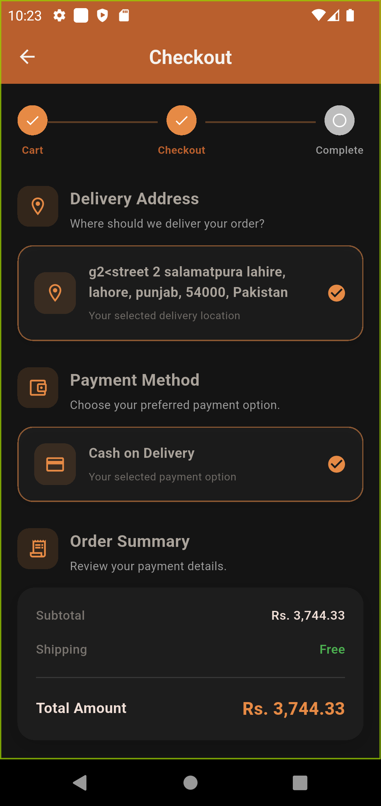
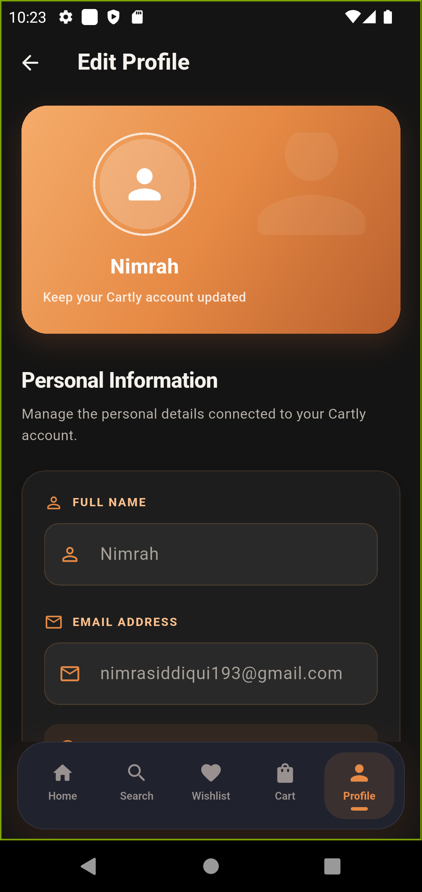

# 🛍️ Cartly — Modern Flutter E-Commerce App

<p align="center">
  A modern e-commerce mobile application built with Flutter and Firebase.
</p>

<p align="center">
  <strong>Discover. Shop. Enjoy.</strong>
</p>

---

## 📱 About Cartly

Cartly is a modern mobile shopping application designed to provide a smooth and convenient online shopping experience.

Built with Flutter and Firebase, it combines product discovery, shopping cart management, wishlist functionality, user profiles, and a complete checkout experience in one application.

Its professional orange-themed interface, elegant layouts, subtle shadows, and light and dark modes create a polished shopping experience.

## ✨ Features

### 🔐 Authentication
- User registration and login
- Firebase Authentication
- User session management

### 🏠 Home & Product Discovery
- Modern home dashboard
- Product browsing
- Product categories
- Product search
- Detailed product information

### ❤️ Wishlist
- Add products to wishlist
- View saved products
- Manage wishlist items

### 🛒 Shopping Cart
- Add products to cart
- Update product quantities
- Remove products
- Automatic subtotal calculation

### 💳 Checkout & Orders
- Delivery address selection
- Payment method selection
- Order summary
- Shipping and discount calculations
- Confirm Order functionality
- Order placement and order history

### 👤 User Profile
- View and edit profile
- Manage personal information
- Manage delivery addresses
- View order history

### 🎨 User Interface
- Professional orange-themed design
- Light and dark themes
- Floating bottom navigation
- Rounded cards and subtle shadows
- Responsive layouts

## 📸 Application Screenshots

### Home Screen
<p align="center">
  
</p>

### Product Details
<p align="center">
  
</p>

### Shopping Cart
<p align="center">
  
</p>

### Checkout
<p align="center">
  
</p>

### Edit Profile
<p align="center">
  
</p>

## 🛠️ Technologies Used

| Technology | Purpose |
|---|---|
| Flutter | Cross-platform development |
| Dart | Programming language |
| Firebase Authentication | User authentication |
| Cloud Firestore | Cloud database |
| Riverpod | State management |
| GoRouter | Navigation and routing |
| Material Design | User interface |

## 🚀 Getting Started

### Prerequisites

- Flutter SDK
- Dart SDK
- Android Studio
- Firebase project configuration

### Installation

**1. Clone the repository**

```bash
git clone https://github.com/nimrasiddiqui193/cartly.git
```

**2. Navigate to the project**

```bash
cd cartly
```

**3. Install dependencies**

```bash
flutter pub get
```

**4. Configure Firebase**

Set up your own Firebase project and configure the required Android and iOS platform files.

**5. Run the application**

```bash
flutter run
```

## 📦 Build APK

Generate a release APK using:

```bash
flutter build apk --release
```

APK location:

```text
build/app/outputs/flutter-apk/app-release.apk
```

## 📂 Project Structure

```text
lib/
├── core/
│   ├── routes/
│   ├── theme/
│   └── utils/
├── data/
│   ├── models/
│   ├── repositories/
│   └── services/
├── features/
│   ├── auth/
│   ├── home/
│   ├── products/
│   ├── search/
│   ├── wishlist/
│   ├── cart/
│   ├── checkout/
│   ├── orders/
│   └── profile/
├── shared/
│   └── widgets/
└── main.dart
```

## 🎯 Project Highlights

Cartly demonstrates practical experience in:

- Cross-platform Flutter development
- Firebase integration
- State management with Riverpod
- Application navigation with GoRouter
- E-commerce workflows
- Reusable UI components
- Responsive interface design
- Light and dark theme implementation

## 👩‍💻 Developer

**Flutter & Mobile Application Development**

GitHub: [@nimrasiddiqui193](https://github.com/nimrasiddiqui193)

**Project Repository:** [Cartly on GitHub](https://github.com/nimrasiddiqui193/cartly)

## 📄 License

This project is developed for educational and portfolio purposes.